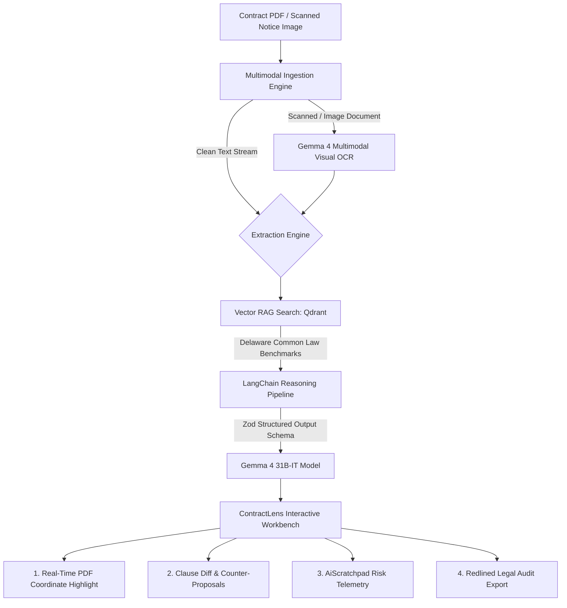

# ContractLens AI 🔍⚖️

> **Production-Ready Legal Risk Intelligence & Counter-Negotiation Workbench powered by Google's Gemma 4 and LangChain.**
>
> Built for the **MLH Hacktoberfest Hack Day • Hyderabad** (Challenge: *Best Use of Gemma 4*).

[](https://opensource.org/licenses/MIT)
[](https://deepmind.google/technologies/gemma/)
[](https://expressjs.com/)
[](https://vitejs.dev/)

---

## 📌 Problem Statement

Every day, developers, startups, and contractors sign agreements, vendor contracts, and NDAs containing predatory or severely one-sided clauses:
- **Uncapped indemnification obligations** that expose parties to unlimited financial liability.
- **Short 48-hour termination for convenience notice** with retention of unearned retainers.
- **Hidden non-compete covenants and unfair dispute escalation venues.**

Traditional legal review is slow and expensive ($500+/hour). Standard LLMs provide generic chatbot summaries that lack verifiable grounding, contract coordinate bounding, or actionable negotiation strategies.

**ContractLens AI** solves this by unlocking information trapped in legal contracts and notice scans through a structured **"See It → Act On It"** pipeline.

---

## ⚡ The "See It → Act On It" Gemma 4 Pipeline



1. **See It:** User uploads any contract document (standard PDF, scanned lease, or physical notice photo).
2. **Gemma 4 Understands:** If the document is visual/scanned, Gemma 4 extracts all covenants verbatim via multimodal OCR.
3. **App Processes & Benchmarks:** Queries a standard reference corpus via Qdrant to benchmark indemnification and liability caps.
4. **Act On It:** Automatically generates redlined counter-clauses, negotiation strategies, and an executive legal audit package.

---

## 🚀 Key Features

- **Multimodal Visual OCR:** Direct image and scanned PDF analysis powered by `gemma-4-31b-it`. Flat scans with no selectable text are transcribed verbatim.
- **Verbatim Bounding-Box Highlights:** Preserves exact text quotes mapped to page coordinates and severity indicators (Critical Red, Warning Orange, Minor Yellow).
- **Automated Counter-Clause Generator:** Generates balanced, mutual counter-proposals designed to protect clients against one-sided covenants.
- **Qdrant Vector Benchmark Search:** Compares risky clauses against standard commercial precedent (`standard_corpus`) to identify discrepancies.
- **AI Scratchpad & Risk Telemetry:** Real-time execution logs, estimated financial exposure calculations, and resolution tracking.
- **Redlined Export:** One-click copy or text download of executive legal summaries and redline negotiation briefs.

---

## 🛠️ Tech Stack

- **AI & Reasoning:** Google Gemma 4 (`gemma-4-31b-it`), `@google/generative-ai`, `@langchain/google-genai`, `@langchain/core`.
- **Vector DB / RAG:** Qdrant (`@qdrant/js-client-rest`), `gemini-embedding-001`.
- **Backend:** Node.js (ES Modules), Express 5, Multer, `pdf-parse`, `p-limit`.
- **Frontend:** React 18, TypeScript, Vite, Tailwind CSS, Zustand, Lucide React, React-PDF.

---

## 🏁 Quickstart Guide

### 1. Prerequisites
- [Node.js](https://nodejs.org/) (v18 or higher)
- Google Gemini API Key with Gemma 4 access

### 2. Clone & Setup
```bash
git clone https://github.com/akash002007/hacktober-fest-gemma-4.git
cd hacktober-fest-gemma-4
npm install
```

### 3. Configure Environment
Copy `.env.example` to `.env` and configure your API key:
```env
GEMINI_API_KEY=your_gemini_api_key_here
QDRANT_URL=http://localhost:6333
QDRANT_COLLECTION=contractlens
MODEL_NAME=gemma-4-31b-it
```

### 4. Run the Backend Server
```bash
node index.js
```
*Backend runs on `http://localhost:5000`.*

### 5. Run the Frontend Client
In a second terminal:
```bash
npm run dev
```
*Frontend runs on `http://localhost:5173`.*

---

## 🧪 Testing with Sample Documents

A pre-configured [`sample.pdf`](./sample.pdf) is included in the root directory. You can also click **"Quick Demo Mode"** in the top navigation bar for an instant walkthrough of the inspection workbench.

---

## 📜 License

Distributed under the [MIT License](./LICENSE). See `LICENSE` for more information.
